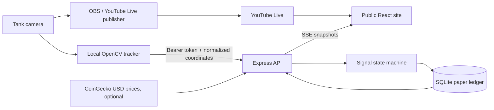

# Architecture

## Flow



The broadcast and decision paths are independent. YouTube's iframe offers playback controls, not raw image frames for browser-side fish tracking; the tracker reads a local or RTSP camera source. Viewer video can be delayed relative to signal timestamps. The interface therefore places the tank map beside the video instead of falsely aligning a marker on a delayed embed.

The public Vercel preview follows a smaller, explicitly simulated path: React polls `/api/snapshot`, which rebuilds a sample baseline and replays admin edits from a dedicated Neon database. The password-protected `/admin` panel edits site copy, stream ID, rules, scenario prices and append-only admin paper trades through `/api/admin`. It has no camera ingest, quote polling or SSE. The diagram above describes the separate persistent Node service for a future real fish session.

## Components

- **React/Vite frontend:** renders the live player, portfolio, benchmark, positions, tank map, history and source links. It never sends a trade request.
- **Express API:** reads a SQLite database, streams snapshots by SSE, validates and authenticates observations, polls a quote provider and records fills or skips.
- **SignalEngine:** pure timed state machine. A selection zone must hold for five seconds; BUY/SELL then requires another five seconds. Each uninterrupted dwell fires once, and a cooldown follows an action.
- **Store:** persists cash, coin units, reference prices, trades, activity and equity points. Each paper fill updates cash, position and trade inside a SQLite transaction.
- **OpenCV bridge:** optional local process detecting an orange fish inside a calibrated crop and posting normalized center coordinates. It is an adjustable baseline, not a trained model for Vlad's actual tank.

## Data contract

`POST /api/ingest/observation`:

```json
{
  "x": 0.43,
  "y": 0.19,
  "confidence": 0.87,
  "observedAt": "2026-11-03T12:00:00Z"
}
```

Coordinates are in the calibrated tank crop, with `(0,0)` at its top-left. The API requires `x`, `y`, and `confidence` in `[0,1]`, rejects observations older than 10 seconds or more than 5 seconds in the future, and uses the server receipt time for dwell calculations. Confidence below `0.55` breaks a dwell. If observations stop for 10 seconds, the public tracker status becomes offline.

## Persistence and event delivery

The SQLite database uses WAL mode. Tables are `settings`, `quotes`, `positions`, `trades`, `activity` and `equity`. Sample records are inserted only when a new demo database is created. A database's mode and asset universe are fixed at initialization, so an older stock ledger cannot be relabelled as a meme-coin portfolio. SSE sends the full public snapshot on connect and then about once per second. The frontend reconnects automatically if the stream drops.

This is a single-process design. To scale across multiple app instances, move the ledger to a shared database with transactional row controls and broadcast state through a shared event bus. Running separate SQLite copies behind a load balancer would split the portfolio.

## Trust boundaries

- `INGEST_TOKEN` stays on the server and local tracker; it is never sent to the browser.
- Only the six catalogued meme-coin symbols are accepted by the price adapter and signal engine.
- Quote API credentials remain server-side.
- Demo prices are marked as scenario values, and sample history is labelled.
- Robinhood is a listing reference, not a price or order integration. The app has no broker credentials, wallet signing or real-money execution path.

The tracker endpoint should be exposed through HTTPS behind a reverse proxy in production, with an appropriately long random token. Restrict ingress to the camera machine where practical.
